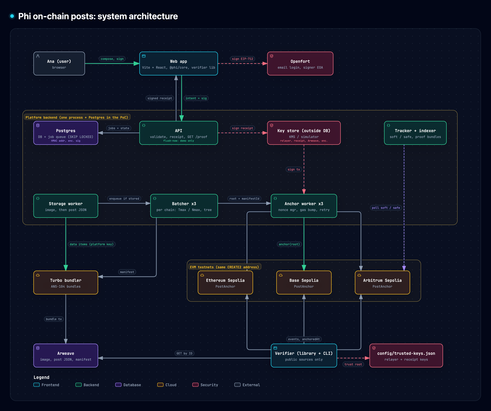
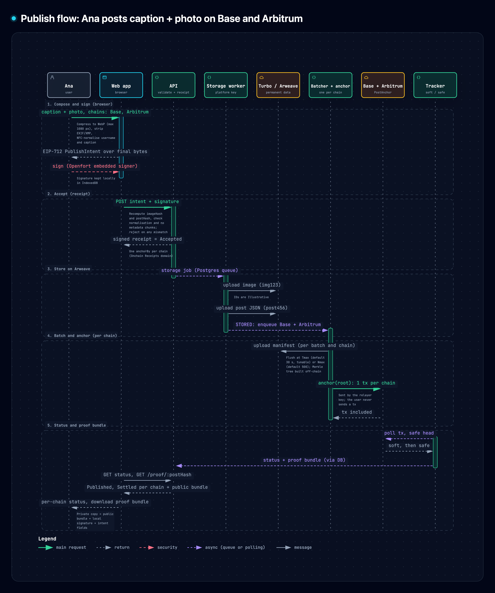
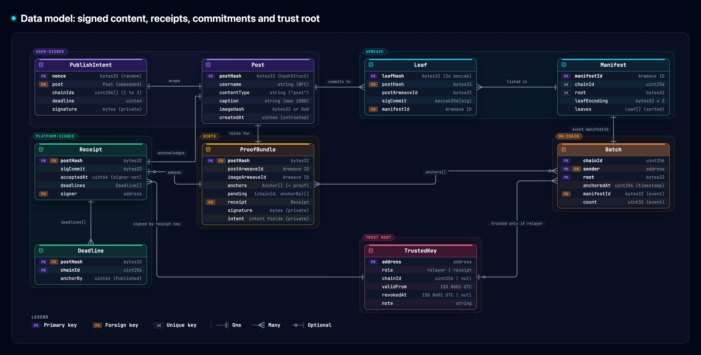
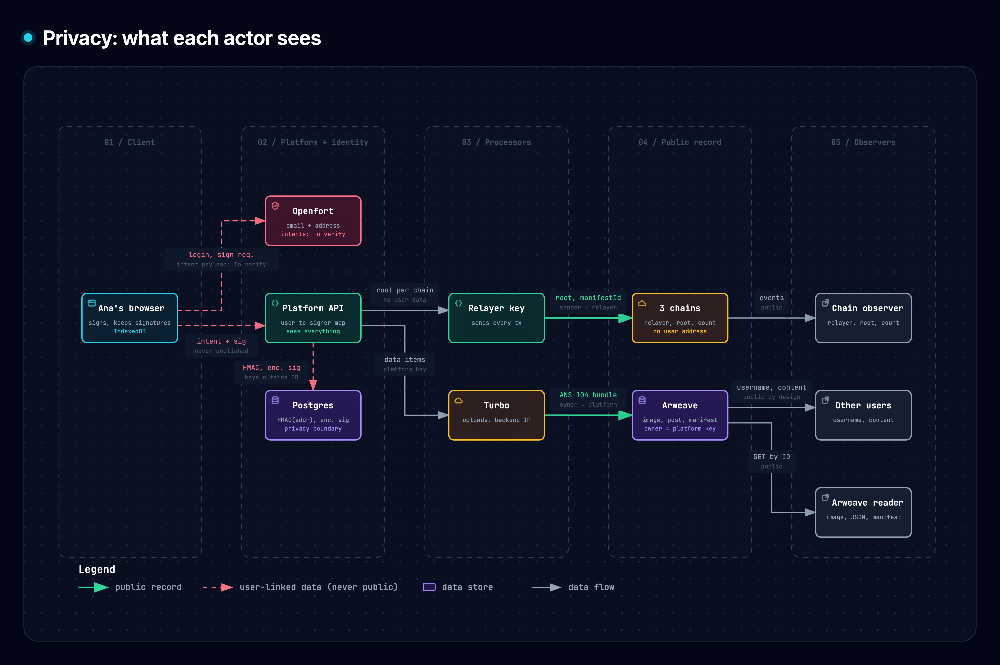
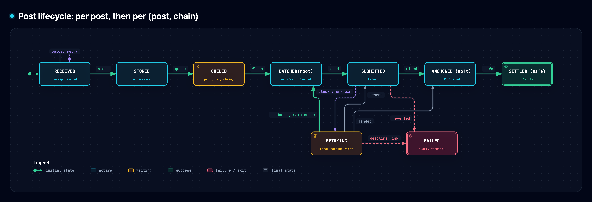
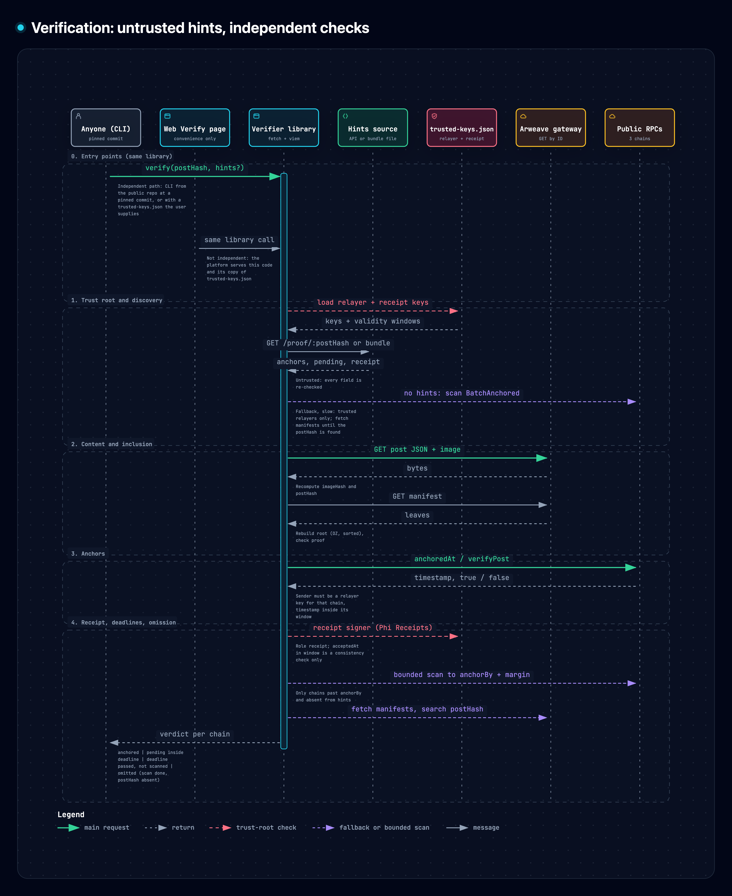

# onchain-posts

Design exercise for EulerPhi (Phi): publish social posts on-chain as efficiently as possible, on up to three chains at once, without ever revealing the author's address.

**Live demo (testnets, demo mode):** https://onchain-posts.gushalk.workers.dev

> **How to read numbers in this repository.** Every number is labelled **Verified** (source URL and date checked), **Estimate** (with a one-line derivation), **To verify** (what must be checked) or **Illustrative** (worked examples). Limits and defaults we choose are marked "(design parameter)" and justified in the ADR that sets them.

## 1. TL;DR

- The user signs an EIP-712 intent in the browser (Openfort embedded account, email login); they never send a transaction and never pay (gasless).
- The platform stores the image and the post JSON on Arweave through the Turbo bundler, signed with a platform key, so the user's key never appears.
- Per chain, posts are batched (flush at Nmax = 500 or after Tmax) and **one transaction per batch** anchors a 32-byte Merkle root on Ethereum Sepolia, Base Sepolia and/or Arbitrum Sepolia.
- Each leaf commits to the post hash, its Arweave ID and `keccak256(signature)` (`sigCommit`), so an author can prove authorship on demand while posts stay unlinkable.
- A signed receipt with a per-chain deadline makes omission provable, and a standalone verifier checks any post against public sources only.

Key benchmark numbers (measured 2026-11-07, gas only, Ethereum mainnet rules, [docs/efficiency.md](docs/efficiency.md)): one batch costs **47,058 gas whatever its size** (47 gas per post at N = 1000), against **22,922 gas per post** with one transaction per post; a plain hash list stays cheaper **below 20 posts per batch**. In money (2026-11-07 snapshot): anchoring costs **USD 0.000067 per post on Ethereum at N = 100**, and a post with a 95 KiB image costs **USD 0.0068 on all three chains**, 96% of it the image storage.

## 2. Requirements

### 2a. The brief, as given

- Design and implement the publication of social content on-chain in the most efficient way possible.
- Each post has: username, content type (`"post"`), caption (text) and an image, if there is one.
- Storage: Arweave, or a better alternative if found.
- Multi-chain: choose 3 blockchains. The user must be able to publish the same post on up to 3 chains at once, choosing which ones.
- Merkle trees are not required; find your own solution.
- Document the full process with diagrams made with Archify (https://github.com/tt-a1i/archify).
- Delivery: a repository link. Deadline: Friday 13 November 2026.
- Evaluated: efficiency and way of thinking, not whether the system works.

### 2b. Added requirements (ours, not in the brief)

| ID | Requirement | Origin |
| -- | ----------- | ------ |
| A1 | **The user's address or public key never appears on-chain, on Arweave, or to other users.** | In the interview the founder said users must be able to use the platform without revealing their public key or wallet address, and that other users must not see it. He said it about the "universal interface"; we apply it voluntarily to posting ([ADR-013](docs/decisions/ADR-013-author-privacy-sigcommit.md)). |
| A2 | A decision log documenting every decision: decision, alternatives, trade-offs, reason. | Ours ([section 10](#10-decision-log)). |
| A3 | A small working web app, minimal scope: compose, per-chain status, Verify page. | Ours ([ADR-019](docs/decisions/ADR-019-web-app-scope.md)). |

Context only, not requirements: long term, Phi cares about account abstraction (Dynamic and smart accounts were mentioned), permissioned tokens, compliance in several countries, on/off ramps and monitoring. Gasless is mandatory in spirit: "instead of making people pay to post content on-chain, we need to find a way to make it gasless".

## 3. Architecture



Interactive version (download and open in a browser): [docs/diagrams/html/01-architecture.html](docs/diagrams/html/01-architecture.html)

The web app (which imports `@onchain-posts/core` and the `@onchain-posts/verifier` library) talks to one backend: a stateless API plus workers (storage, one batcher and one anchor worker per chain, a tracker), with Postgres as both database and queue. All platform keys (relayer, receipt, Arweave data-item signer, signature-encryption key) live in an external key store: a KMS in production, a simulator behind the same interface in the PoC. Content goes to Arweave through Turbo; roots go to the same `PostAnchor` contract on three chains. Openfort provides email login and the signing identity only. The verifier reads only public sources (an Arweave gateway, public RPCs) plus `config/trusted-keys.json`. Details: [ADR-016](docs/decisions/ADR-016-backend-architecture.md).

## 4. Publish flow



Interactive version (download and open in a browser): [docs/diagrams/html/02-publish-flow.html](docs/diagrams/html/02-publish-flow.html)

Example: **Ana publishes a post with caption and photo on Base and Arbitrum.** IDs and times are Illustrative.

1. **Browser.** The image is compressed to WebP and its EXIF/XMP chunks are stripped; username and caption are NFC-normalised. Ana signs the EIP-712 `PublishIntent` over the final bytes and strings (chains: Base Sepolia and Arbitrum Sepolia). The web app stores the signature locally (IndexedDB).
2. **Backend.** It validates everything (recomputes `imageHash` and `postHash`, checks normalisation and the absence of metadata, rejects on any mismatch) and returns a signed receipt: **Accepted**, with one `anchorBy` per chosen chain. It then uploads the image (ID `img123`) and the post JSON (ID `post456`) to Arweave via Turbo.
3. **Queues.** Once stored, the post enters the Base queue and the Arbitrum queue.
4. **Anchoring, per chain, on flush** (Tmax or Nmax, [ADR-006](docs/decisions/ADR-006-batching-policy.md)): build the Merkle tree of the queued posts, upload the manifest, send **one** transaction anchoring the root.
5. **Status.** Ana sees per-chain status: **Published** (soft confirmation), then **Settled** (safe head). She can download her proof bundle: the public part from `GET /proof/:postHash`, with her signature added locally.

## 5. Data model



Interactive version (download and open in a browser): [docs/diagrams/html/05-data-model.html](docs/diagrams/html/05-data-model.html)

| Object | Where | Shape |
| ------ | ----- | ----- |
| `Post` | Signed by the user, identical on every chain | EIP-712 `Post { string username; string contentType; string caption; bytes32 imageHash; uint64 createdAt }`; `postHash = hashStruct(Post)` |
| `PublishIntent` | Signed by the user, never published | `PublishIntent { Post post; uint256[] chainIds; bytes32 nonce; uint64 deadline }`, domain "Onchain Posts" without chainId |
| Leaf | Inside the Merkle tree | `keccak256(bytes.concat(keccak256(abi.encode(postHash, postArweaveId, sigCommit))))`, no chainId |
| Manifest | Arweave, one per batch and chain | `onchain-posts.manifest/1`: chainId, root, leaf encoding and the leaves |
| Arweave tags | Public, indexed | `App-Name`, `Type`, `Post-Hash` / `Image-Hash` / `Merkle-Root`, `Chain-Id`; **no username tag** |
| Proof bundle | `GET /proof/:postHash` (public) and the user's private copy | `onchain-posts.proof/1`: anchors per chain with Merkle proofs, pending chains with `anchorBy`, the receipt; the signature and the private intent fields (`chainIds`, `nonce`, `deadline`, needed to recompute the signed digest) only in the private copy |
| Receipt | Returned at acceptance | EIP-712 domain "Onchain Receipts": `Receipt { bytes32 postHash; bytes32 sigCommit; uint64 acceptedAt; Deadline[] deadlines }` |

Details: [ADR-012](docs/decisions/ADR-012-signature-scheme-eip712.md) (signatures), [ADR-014](docs/decisions/ADR-014-data-model.md) (data model, tags, proof bundle, versioning), [ADR-015](docs/decisions/ADR-015-signed-receipts.md) (receipts).

## 6. Efficiency

Efficiency is four metrics, not one: end-to-end cost per post, on-chain bytes per post, gas per batch and per post, and latency per stage (p50 / p95). Gas is measured with real transactions on a local node running Ethereum mainnet rules (Ethereum Sepolia currently prices gas differently from mainnet, so it is not the gas reference); money uses mainnet prices on a stated date, with the L2 L1-data fee read from mainnet oracles. Storage is reported both inside Turbo's free tier, which covers the PoC (10 MiB lifetime allowance per wallet, Verified 2026-11-07, [ADR-002](docs/decisions/ADR-002-storage-arweave-turbo.md)), and at list price, the production figure. Method: [ADR-001](docs/decisions/ADR-001-efficiency-definition.md); full page: [docs/efficiency.md](docs/efficiency.md).

**Gas per post, Ethereum mainnet rules** (measured 2026-11-07: `node packages/bench/src/gas-bench.mjs`, results in [`packages/bench/results/2026-11-07-gas-local-prague.json`](packages/bench/results/2026-11-07-gas-local-prague.json))

| Variant | What it is | N = 1 | N = 10 | N = 100 | N = 500 | N = 1000 |
| ------- | ---------- | ----- | ------ | ------- | ------- | -------- |
| B0 | Content in storage, 1 tx per post (100-byte caption) | 181,675 | 181,675 | 181,675 | 181,675 | 181,675 |
| B1 | postHash event, 1 tx per post | 22,922 | 22,922 | 22,922 | 22,922 | 22,922 |
| B2 | N postHashes in one event per batch | 24,342 | 3,463 | 1,495 | 1,320 | 1,298 |
| ours-lite | Root in an event, no storage | 24,629 | 2,463 | 246 | 49 | 25 |
| ours | Root + one storage slot | 47,058 | 4,706 | 471 | 94 | 47 |

**Crossovers** (measured, gas only, mainnet L1 rules; details in [ADR-001](docs/decisions/ADR-001-efficiency-definition.md)):

- ours vs B1: ours costs more at N = 1 and 2 (the price of on-chain idempotency and contract readability) and is cheaper from **N >= 3**.
- ours vs B2: cheaper from **N >= 20** (estimated at 34 before measuring: B2 pays the EIP-7623 calldata floor, about 1,280 gas per post instead of 770). ours-lite vs B2: from **N >= 2**.
- The storage slot that gives on-chain idempotency costs 22,432 gas per batch (ours minus ours-lite).
- Stated openly: **below 20 posts per batch on L1 a plain hash list is cheaper.** Merkle with a slot is chosen for constant on-chain size at any N, idempotency and contract-level inclusion proofs, not because it is always cheaper ([ADR-005](docs/decisions/ADR-005-commitment-merkle-tree.md) states when to revisit).

**USD per post** (snapshot 2026-11-07: `node packages/bench/src/cost-snapshot.mjs`, results in [`packages/bench/results/2026-11-07-cost-snapshot.json`](packages/bench/results/2026-11-07-cost-snapshot.json); ETH/USD 2,233.09, base fee 0.0637 gwei on Ethereum, 0.005 on Base, 0.0201 on Arbitrum One)

| Cost per post | N = 1 | N = 10 | N = 100 | N = 1000 |
| ------------- | ----- | ------ | ------- | -------- |
| Anchoring with ours, Ethereum | 0.0067 | 0.00067 | 0.000067 | 0.0000067 |
| Anchoring with ours, Base | 0.00063 | 0.000063 | 0.0000063 | 0.00000063 |
| Anchoring with ours, Arbitrum One | 0.0021 | 0.00021 | 0.000021 | 0.0000021 |
| Post with a 95 KiB image, all three chains (storage at list price + anchoring) | 0.0162 | 0.0076 | 0.0068 | 0.0067 |

The image storage (USD 0.0065 at list price) dominates from N = 100 on: past that point the cost is moved by the image cap and the storage price, not by Merkle versus hash list. Arbitrum's execution gas is measured without the calldata floor (it applies none) and cross-checked on mainnet with `eth_estimateGas`; details in [docs/efficiency.md](docs/efficiency.md).

**Limitations.** Gas is measured on local nodes with each chain's calldata rules and cross-checked with mainnet estimates, not yet on deployed contracts; USD values depend on the snapshot. The live demo runs small batches in demo mode and is not the efficiency proof; the benchmark is.

Planned diagrams, produced at the end from real benchmark data: **Timeline** (batching example) and **Waterfall** (latency breakdown).

## 7. Privacy and threat model



Interactive version (download and open in a browser): [docs/diagrams/html/03-privacy.html](docs/diagrams/html/03-privacy.html)

| Actor | Sees | Does not see |
| ----- | ---- | ------------ |
| Chain observer | Relayer address, root, manifestId, count, timing | User address, signature, content |
| Arweave reader | Image, post JSON (with username and caption), manifest (postHash, postArweaveId, sigCommit); owner field = platform key | User address, public key, signature |
| Turbo | The uploads (same as Arweave), the backend's IP, timing | User address, signature |
| Openfort | Email and embedded-account address; signing happens in its iframe, and in a recorded run no request to Openfort carried the `PublishIntent` payload ([ADR-011](docs/decisions/ADR-011-identity-openfort.md)) | Platform database |
| Platform | Everything: user to signer mapping (stored as an HMAC), signatures (encrypted with a key outside the database), request IPs | Nothing is hidden from the platform |
| Other users | Username and content | Address, public key, signature |
| The user's own browser | Their signatures in IndexedDB | Other users' data |

The user's address and signature appear nowhere public. Openfort is the only third party that could link email, address and, possibly, posts. What an observer can still infer (timing correlation, chosen chain set, writing style, image size) is listed in [docs/threat-model.md](docs/threat-model.md) and [ADR-013](docs/decisions/ADR-013-author-privacy-sigcommit.md).

## 8. Trust assumptions and failure modes



Interactive version (download and open in a browser): [docs/diagrams/html/04-lifecycle.html](docs/diagrams/html/04-lifecycle.html)

- **Lifecycle.** Per post: `RECEIVED -> STORED`. Per (post, chain): `QUEUED -> BATCHED(root) -> SUBMITTED(txHash) -> ANCHORED (soft) -> SETTLED (safe)`, with `RETRYING` and `FAILED` (alert) ([ADR-016](docs/decisions/ADR-016-backend-architecture.md)).
- **Receipts.** At acceptance the backend returns a receipt signed by a dedicated receipt key, with one `anchorBy` per chain; `anchorBy` refers to inclusion ("Published"), not to "Settled" ([ADR-015](docs/decisions/ADR-015-signed-receipts.md)).
- **Retries and idempotency.** The contract rejects an already anchored (sender, root). Stuck transactions are replaced with the same nonce; reverted ones raise an alert without blind retry; unknown outcomes are resolved by checking the receipt first. A re-batch of a stuck batch must reuse the stuck transaction's nonce so only one version can land ([ADR-008](docs/decisions/ADR-008-multichain-orchestration.md)).
- **Trust root: `config/trusted-keys.json`.** The relayer addresses (per chain) and the receipt-signing address, each with `validFrom` and `revokedAt`, versioned in this repository and read by the verifier. Rotation adds an entry; **revocation is off-chain only** (the contract has no admin). Anchors made by a compromised relayer key before detection stay on-chain and are excluded only by the revocation date ([ADR-009](docs/decisions/ADR-009-anchor-contract.md)).
- **Receipt key compromise.** `acceptedAt` is declared by the signer, not by a chain, so an attacker holding the receipt key can sign receipts with an `acceptedAt` before the revocation date and they pass the trusted-keys window check. Every receipt signed by that key becomes disputable, including genuine ones; revocation cannot bound it, and such receipts could be used to accuse the platform falsely of omitting posts that never existed. A cheap mitigation (periodically anchoring a hash of issued receipts) is future work (ADR-015).
- **Other trust assumptions.** Turbo settles what it made readable; the manifest stays available on Arweave (needed to build proofs); sequencer soft confirmations are rarely reverted; Openfort custody of user keys.
- **What receipts and sigCommit do not cover.** Receipts make omission provable; sigCommit lets genuine authors prove authorship. Neither prevents the platform from fabricating posts: that requires the per-batch validity proof (future work).

## 9. Verification



Interactive version (download and open in a browser): [docs/diagrams/html/06-verification.html](docs/diagrams/html/06-verification.html)

Anyone can verify a post without trusting us, with the `@onchain-posts/verifier` package. Principle: **untrusted hints, independent verification.**

- Hints can come from our API (`GET /proof/:postHash`) or from the user's proof bundle. They only save discovery time; without hints the verifier scans `BatchAnchored` events of the trusted relayers (slow fallback).
- The verifier re-derives and re-checks everything against public sources and `config/trusted-keys.json`: it fetches the post JSON and image by Arweave ID, recomputes `imageHash` and `postHash`, rebuilds the root from the manifest and checks the proof, checks `anchoredAt` / `verifyPost` for a sender listed as relayer with the anchor time inside the key's window, and verifies the receipt with the "Onchain Receipts" EIP-712 domain against a listed receipt key.
- Per chain it reports: anchored (flagged late if anchored after `anchorBy`), pending inside deadline, deadline passed but not scanned (or scan incomplete), or omitted. **A verdict of "omitted" is never derived from hints alone**: it requires the bounded scan of the trusted relayers' `BatchAnchored` events between `acceptedAt` and `anchorBy` plus a margin, with every manifest in that window searched ([ADR-015](docs/decisions/ADR-015-signed-receipts.md)).

Implemented in [`packages/verifier`](packages/verifier/README.md): a library and the `pnpm verify <postHash> [--hints <bundle.json>] [--scan]` CLI, tested end to end against local nodes running `PostAnchor` at its real address (17 tests, including omission only after a complete bounded scan, untrusted or revoked relayers, tampered hints and tampered content).

**Real post on the testnets**: to be recorded (postHash, Arweave IDs, one anchor per chain and the `pnpm verify` command to check it without our backend).

Honest note: **the Verify page inside the web app is a convenience, not independent verification**, because the platform serves both the code and its copy of `trusted-keys.json`. Independent verification means running the CLI from the public repository at a pinned commit, or with a `trusted-keys.json` the user supplies.

## 10. Decision log

Template: [ADR-000](docs/decisions/ADR-000-template.md).

| # | Decision | One-line reason | Confidence | Reversibility |
| - | -------- | --------------- | ---------- | ------------- |
| [001](docs/decisions/ADR-001-efficiency-definition.md) | Efficiency = four metrics, measured against baselines B0, B1, B2, ours-lite | One number hides the trade-offs; honest rivals make wins credible | High | Reversible |
| [002](docs/decisions/ADR-002-storage-arweave-turbo.md) | Arweave via the Turbo bundler, platform signing key | Only cheaper options exist and they give up permanence | High | Reversible |
| [003](docs/decisions/ADR-003-arweave-layout-image-limits.md) | Three data items; image at most 95 KiB, rejected otherwise | Permanent storage paid by us: bounded cost per post, no server-side transforms after signing | Medium | Reversible |
| [004](docs/decisions/ADR-004-what-goes-on-chain.md) | Only the batch root + one storage slot on-chain | Constant cost per batch; nothing about the user on-chain | High | One-way door |
| [005](docs/decisions/ADR-005-commitment-merkle-tree.md) | Binary Merkle tree (OpenZeppelin conventions) | Constant size at any N and contract-level inclusion proofs; benchmarked against a hash list | Medium | One-way door |
| [006](docs/decisions/ADR-006-batching-policy.md) | Per-chain queue, flush at Nmax or Tmax | Receipts decouple UX from anchoring, so batching costs little latency | High | Reversible |
| [007](docs/decisions/ADR-007-chain-selection.md) | Ethereum Sepolia, Base Sepolia, Arbitrum Sepolia | L1 shows the savings, L2s show latency, one codebase; Solana dropped for time | Medium | Reversible |
| [008](docs/decisions/ADR-008-multichain-orchestration.md) | Independent anchoring per chain, same-nonce replacement for retries | No bridge needed; duplicates blocked on-chain | High | Reversible |
| [009](docs/decisions/ADR-009-anchor-contract.md) | Permissionless `PostAnchor` keyed by sender, no admin | No privileged role; front-running cannot block us; trust roots off-chain | High | One-way door |
| [010](docs/decisions/ADR-010-gasless-relayer.md) | Platform relayer sends all transactions | Every user-sent or AA alternative exposes the user's address as sender | High | Reversible |
| [011](docs/decisions/ADR-011-identity-openfort.md) | Openfort embedded account as signing identity only | Email login and recovery without exposing the account on-chain | Medium | Reversible |
| [012](docs/decisions/ADR-012-signature-scheme-eip712.md) | EIP-712, content (`Post`) separated from intent (`PublishIntent`) | Deterministic encoding of exactly what is signed; same postHash on every chain | High | Reversible |
| [013](docs/decisions/ADR-013-author-privacy-sigcommit.md) | Private user signature + `sigCommit` in the leaf | Authorship provable on demand, posts unlinkable, 0 extra gas | High | One-way door |
| [014](docs/decisions/ADR-014-data-model.md) | Leaf with postArweaveId, manifest, tags without username, proof bundle | Verification by ID without indexers; no indexable user dimension | Medium | One-way door |
| [015](docs/decisions/ADR-015-signed-receipts.md) | Signed receipts with a per-chain `anchorBy` | Makes omission provable; separate key and domain | High | Reversible |
| [016](docs/decisions/ADR-016-backend-architecture.md) | TypeScript backend, Postgres as database and queue, keys outside the DB | Fewest moving parts for the PoC; DB dump reveals no addresses | High | Reversible |
| [017](docs/decisions/ADR-017-confirmation-semantics.md) | Accepted / Published / Settled | Three labels with precise per-chain meanings | High | Reversible |
| [018](docs/decisions/ADR-018-abuse-cost-control.md) | Rate limits, size caps, budget caps, protected demo flush | Permanent storage and gas are paid by us | Medium | Reversible |
| [019](docs/decisions/ADR-019-web-app-scope.md) | Minimal web app (Proposed) | Enough to demo the flow and the Verify page, nothing more | Medium | Reversible |

## 11. How to run

Available now (requires Foundry and Node 20 or later; clone with `--recurse-submodules`, or run `git submodule update --init --recursive`):

```bash
# Install the TypeScript workspace, then run every test (packages/core with vitest, contracts with Foundry)
pnpm install
pnpm test

# Gas benchmark: local node with mainnet rules, no backend needed (ADR-001)
node packages/bench/src/gas-bench.mjs
node packages/bench/src/calldata-floor-probe.mjs

# CREATE2 deployment, same address on the three testnets (needs a funded key to broadcast)
cd contracts && forge script script/DeployPostAnchor.s.sol --rpc-url <rpc> --broadcast --private-key <key>
```

```bash
# Verify a post from public sources only (optionally with untrusted hints); real posts need the deployment
# and the real keys in config/trusted-keys.json first
pnpm verify <postHash>
pnpm verify <postHash> --hints <bundle.json> --scan
```

```bash
# Backend (API + workers) and Postgres; see packages/backend/README.md
cp .env.example .env        # set POSTGRES_*, DB_HMAC_SECRET, the RPC URLs and STORAGE_MODE
docker compose up --build
docker compose exec backend node dist/print-keys.js   # public relayer and receipt addresses for config/trusted-keys.json
```

Web app (see [packages/web/README.md](packages/web/README.md)): the VITE_* variables of the root `.env`, then `pnpm --filter @onchain-posts/web dev` on http://localhost:5173. It signs with the Openfort embedded wallet when the Openfort keys are set, and with a development key otherwise.

**Deployment.** The live demo at https://onchain-posts.gushalk.workers.dev is the static web build served by Cloudflare Workers (`packages/web/wrangler.jsonc`, static assets only). The backend and Postgres run from this `docker-compose.yml` on a VPS with Dokploy, behind its Traefik proxy with HTTPS at https://onchain-posts-backend.tesselium.com. Steps: [packages/web/README.md](packages/web/README.md) and [packages/backend/README.md](packages/backend/README.md).

**Deployment.** `PostAnchor` is live at `0xD0fB2A7F1D12C5AF80E49B31Bcb1B4983AD7C5dB` on the three testnets, with identical runtime bytecode (keccak `0x6b515179...d6d5`, equal to the local build):

| Chain | Deployment transaction | Block | Gas used |
| ----- | ---------------------- | ----- | -------- |
| Ethereum Sepolia | [0x342de0c1...](https://sepolia.etherscan.io/tx/0x342de0c19f1987bd30c506f3b324a62e9df4d8dac80300f29ae8862d214f4801) | 12,093,208 | 1,899,086 |
| Base Sepolia | [0x26cdad46...](https://sepolia.basescan.org/tx/0x26cdad4683ecc4b2349ce051374a7b8d626e27e3c13ee37925beddaa4ce3ea9f) | 56,262,308 | 290,246 |
| Arbitrum Sepolia | [0xeb00ff21...](https://sepolia.arbiscan.io/tx/0xeb00ff21cdf67aa740cc07a7af198ee90d27ae74322c8390841aff2983922082) | 327,362,493 | 290,246 |

Ethereum Sepolia used 6.5 times the gas of the L2s for the same deployment: it currently runs a different gas schedule from mainnet (ADR-001), and forge's local simulation, which uses mainnet rules, underestimated it, so the deployment there needed `--skip-simulation` to take the node's estimate.

**DEMO_MODE.** The live demo uses a short Tmax or a "flush now" button so "Published" appears quickly. Both are clearly labelled as demo behaviour; the flush-now endpoint spends a transaction per chain per call, so it is protected by `DEMO_FLUSH_TOKEN` and rate-limited ([ADR-006](docs/decisions/ADR-006-batching-policy.md), [ADR-018](docs/decisions/ADR-018-abuse-cost-control.md)). Demo mode is not the efficiency configuration.

## 12. Limitations and future work

- **Per-batch ZK validity proof** ([ADR-005](docs/decisions/ADR-005-commitment-merkle-tree.md)): proves that every leaf carries a valid signature of a registered user without revealing who. It is the mechanism ADR-015 refers to: "Neither prevents the platform from fabricating posts: that requires the per-batch validity proof (future work)."
- **Platform-lock co-signer**: a hard lock of accounts to the platform needs an on-chain 2-of-2 co-signer; documented, not implemented ([ADR-011](docs/decisions/ADR-011-identity-openfort.md)).
- **Moderation pipeline** before upload: required in production, because permanent storage also means permanent illegal content ([ADR-018](docs/decisions/ADR-018-abuse-cost-control.md)).
- **GDPR handling**: permanence vs the right to erasure; risk documented, mitigations listed, not legal advice ([ADR-018](docs/decisions/ADR-018-abuse-cost-control.md)).
- **Universal-interface privacy layer**: hiding a user's own on-chain interactions is an open problem ([ADR-013](docs/decisions/ADR-013-author-privacy-sigcommit.md)).
- **Non-EVM adapter** (Solana via the Memo program): dropped for time ([ADR-007](docs/decisions/ADR-007-chain-selection.md)).
- **Receipt-hash anchoring**: periodic on-chain anchoring of issued receipt hashes, to limit the damage of a receipt key compromise ([ADR-015](docs/decisions/ADR-015-signed-receipts.md)).

**Delivery priority.** Later blocks follow this order; progress is tracked item by item in [ROADMAP.md](ROADMAP.md):

| Tier | Scope | Depends on |
| ---- | ----- | ---------- |
| 1: the evidence and the reasoning (must ship) | Contract + invariant tests + benchmark with baselines B0, B1, B2, ours-lite and ours; `packages/core`; verifier; docs and diagrams | Nothing: the gas benchmark runs in Foundry without the backend |
| 2: minimal pipeline | Backend as a single process with Postgres, Turbo uploads, anchoring on the 3 testnets | Tier 1 |
| 3: minimal web | Compose, per-stage status, Verify page | Tier 2 |

Solana is dropped ([ADR-007](docs/decisions/ADR-007-chain-selection.md)).
